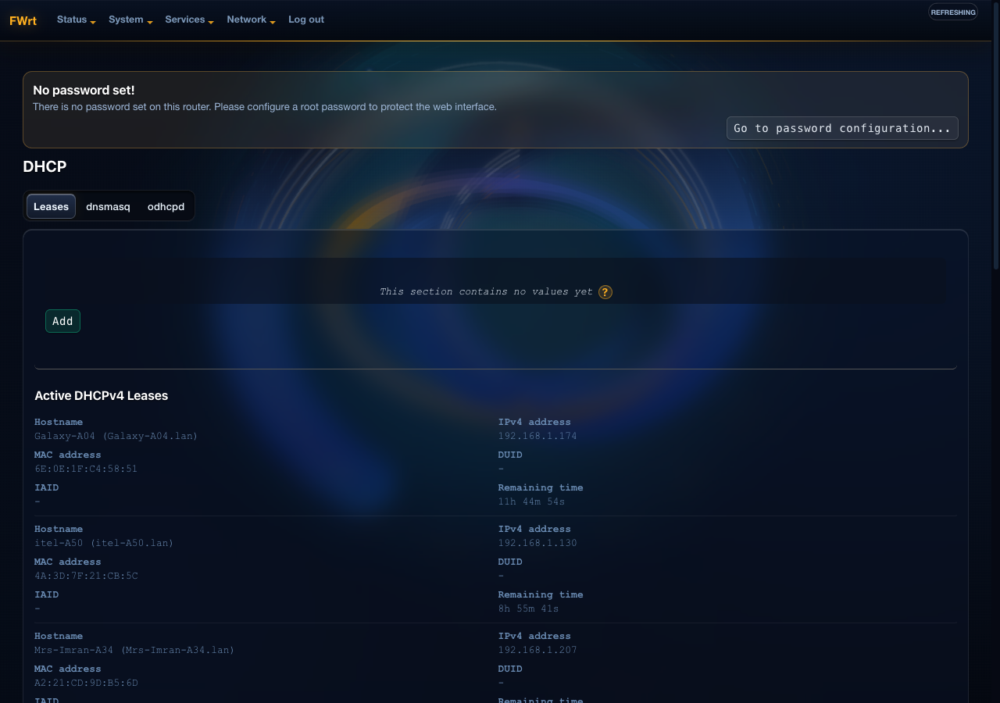

# luci-theme-fwrt

A modern, high-contrast dark theme for OpenWrt LuCI.

## Screenshots

### System Overview


### Wireless Interfaces


### Network & DHCP Configuration


### Firewall Zones


## Features

- **Dark Mode Interface**: Deep navy-black background with amber accents, optimized for contrast and readability.
- **Hardware Status Indicators**: Clear color-coded indicators for Ethernet ports, wireless radios, and system load.
- **Responsive Layout**: Adapts cleanly across mobile, tablet, and desktop viewports.
- **Interactive Help Disclosures**: Field helper descriptions tucked behind clickable `?` badges to reduce visual clutter.
- **Smoother Realtime Charts**: Hardware-accelerated SVG bandwidth and WiFi frequency graphs.

## Compatibility

- OpenWrt 21.02+ (ucode-based LuCI)
- OpenWrt 23.05
- OpenWrt 24.10
- OpenWrt SNAPSHOT

## Installation

### Via opkg (Once available in official feeds)

```sh
opkg update
opkg install luci-theme-fwrt
```

### Manual Installation (.ipk)

Download the latest `.ipk` package from [Releases](https://github.com/FhDBro/luci-theme-fwrt/releases), upload it to your router, and install:

```sh
opkg install luci-theme-fwrt_*.ipk
```

### Building from Source

In your OpenWrt SDK or buildroot:

```sh
cd package/feeds/luci/
git clone https://github.com/FhDBro/luci-theme-fwrt.git
make menuconfig # LuCI -> Themes -> luci-theme-fwrt
make package/luci-theme-fwrt/compile
```

## Configuration

To set as the active theme via UCI:

```sh
uci set luci.main.mediaurlbase='/luci-static/fwrt'
uci commit luci
/etc/init.d/uhttpd restart
```

## License

Licensed under the Apache License, Version 2.0.
