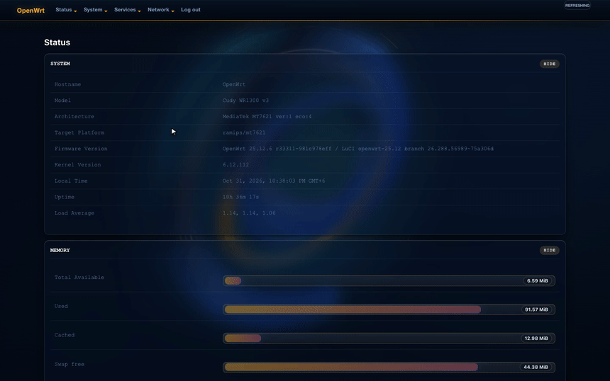
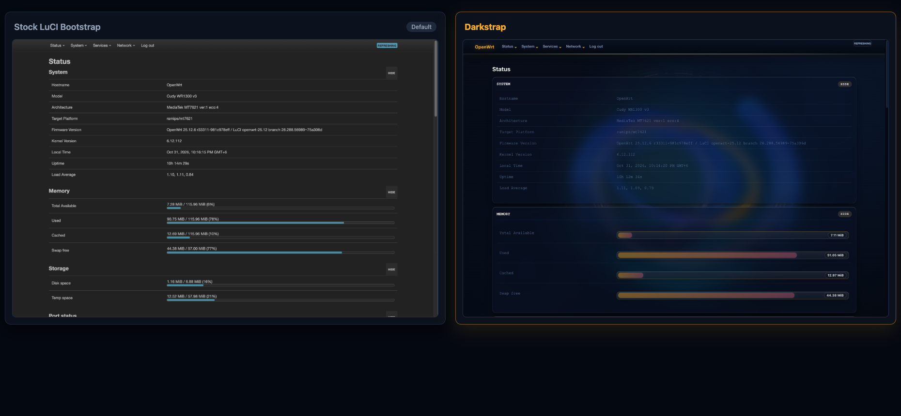
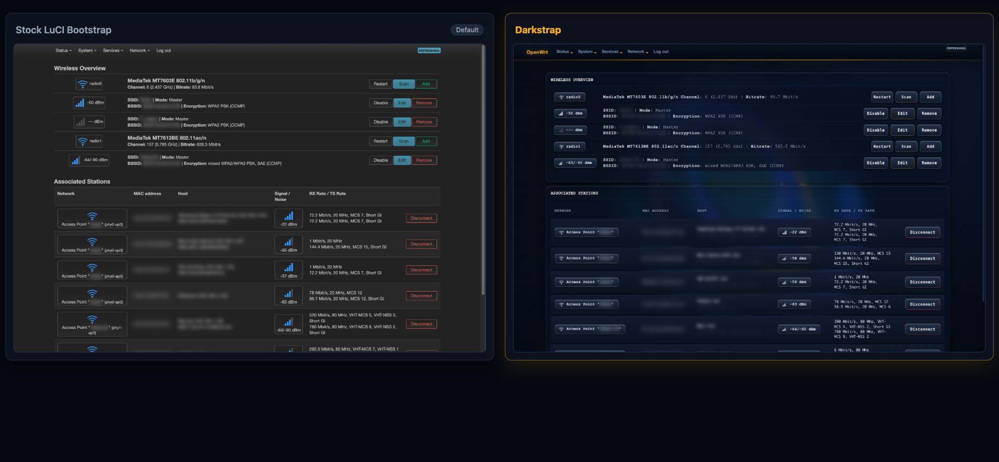
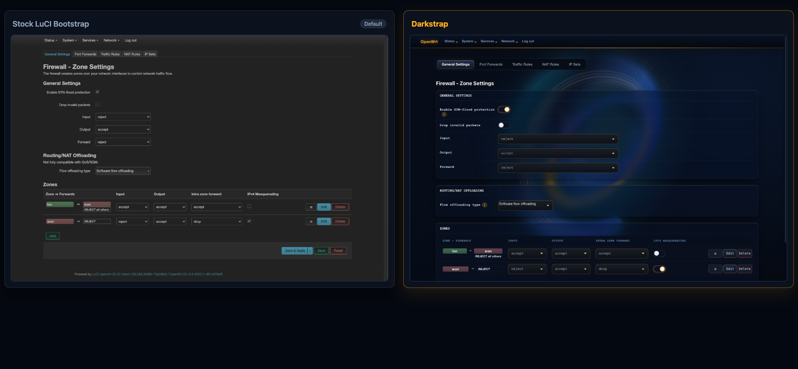
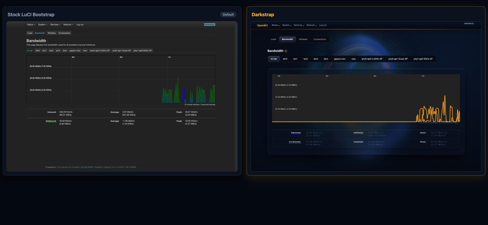

# luci-theme-darkstrap

A high-contrast dark theme for OpenWrt LuCI, built on top of the official Bootstrap theme.

Designed for readability in low-light environments, with clear visual hierarchy, distinct status badges, and zero external dependencies.

## Preview



## Comparison with Stock LuCI Bootstrap

| Page | Stock Bootstrap vs Darkstrap |
| :--- | :--- |
| **System Overview** |  |
| **Wireless Interfaces** |  |
| **Firewall Zones** |  |
| **Realtime Bandwidth** |  |

## Key Changes

- Deep obsidian background with warm amber action accents.
- Preserves 100% of upstream LuCI DOM structure and accessibility semantics.
- Replaces raw checkboxes in firewall and service views with animated toggle switches.
- Field help descriptions tucked behind clickable `?` indicators to reduce visual noise.
- Distinct color-coded badges for network interfaces (green LAN, red WAN, blue bridges).
- Hardware-accelerated SVG realtime bandwidth curves with legible contrast.
- Fully responsive across mobile, tablet, and desktop viewports.

## Compatibility

- OpenWrt 21.02, 22.03, 23.05, 24.10, and SNAPSHOT.
- Compatible with all LuCI ucode-based releases.

## Installation

### Manual Installation (.ipk)

Download the latest `.ipk` package from [Releases](https://github.com/FhDBro/luci-theme-darkstrap/releases), copy it to your router, and install:

```sh
opkg install luci-theme-darkstrap_*.ipk
```

### Building from Source

In your OpenWrt SDK or buildroot tree:

```sh
cd package/feeds/luci/
git clone https://github.com/FhDBro/luci-theme-darkstrap.git
make menuconfig # LuCI -> Themes -> luci-theme-darkstrap
make package/luci-theme-darkstrap/compile
```

## Activation via UCI

To set Darkstrap as the default active theme:

```sh
uci set luci.main.mediaurlbase='/luci-static/darkstrap'
uci commit luci
/etc/init.d/uhttpd restart
```

## License

Licensed under the Apache License, Version 2.0.
