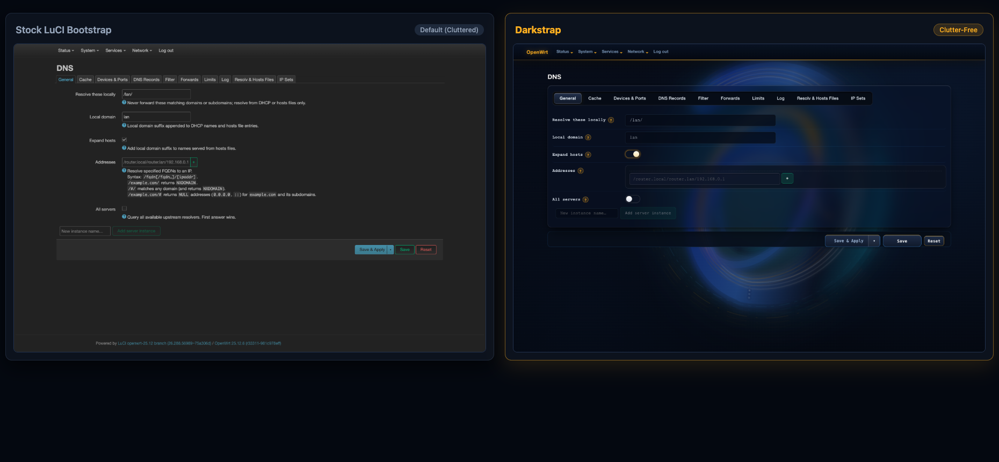
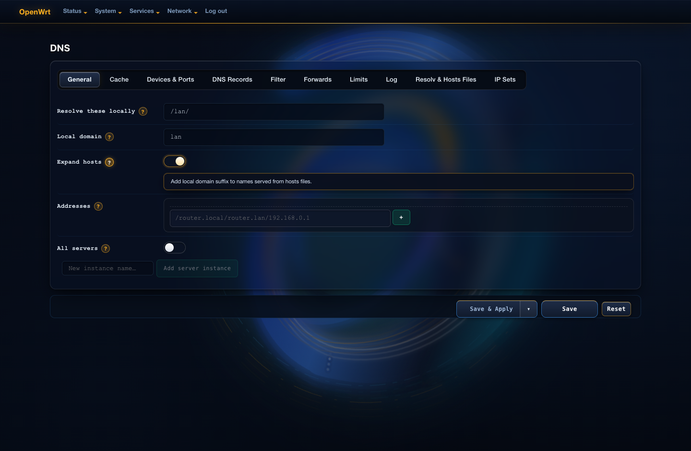
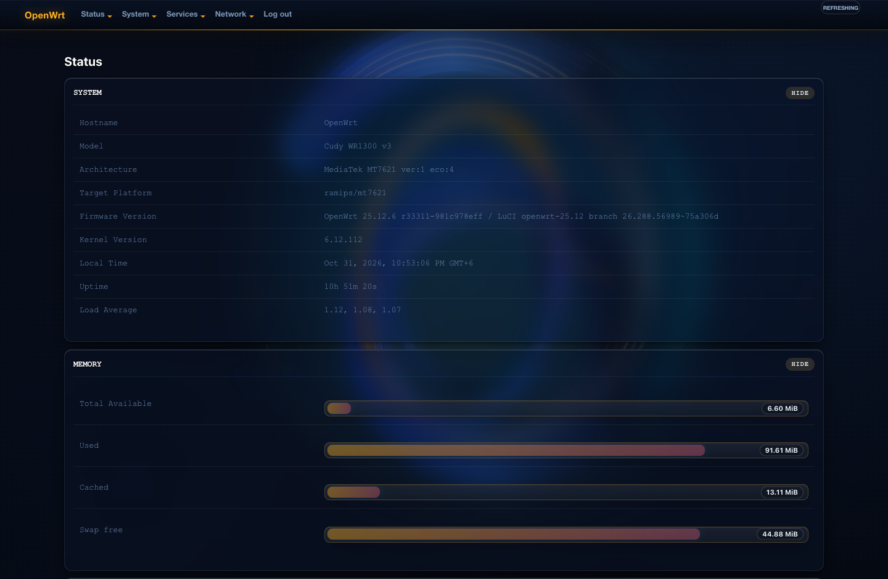
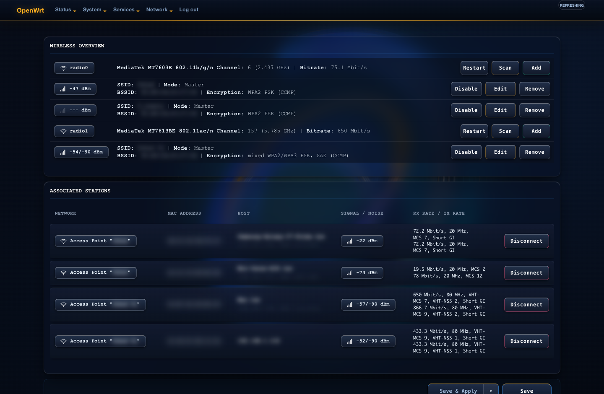
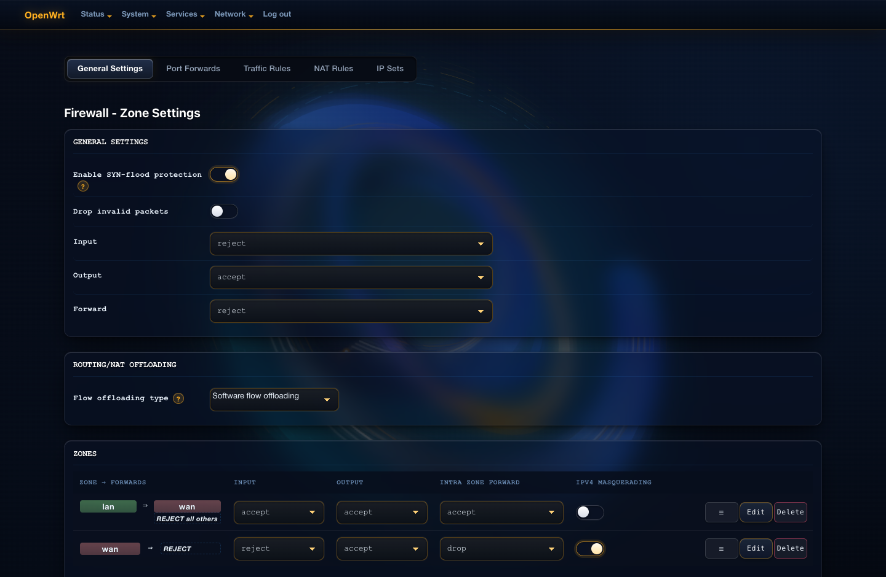
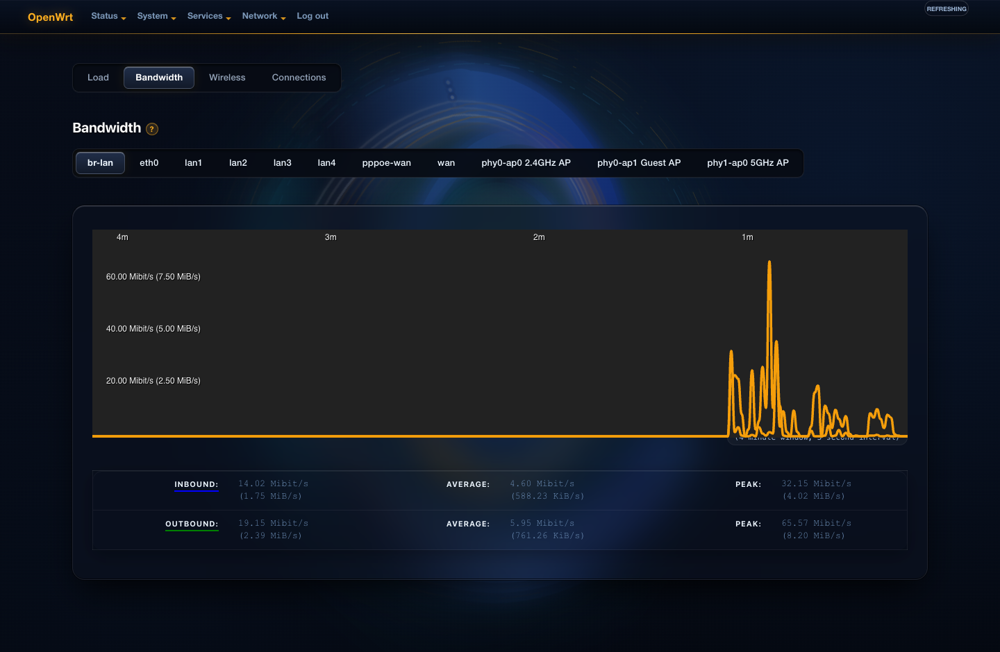
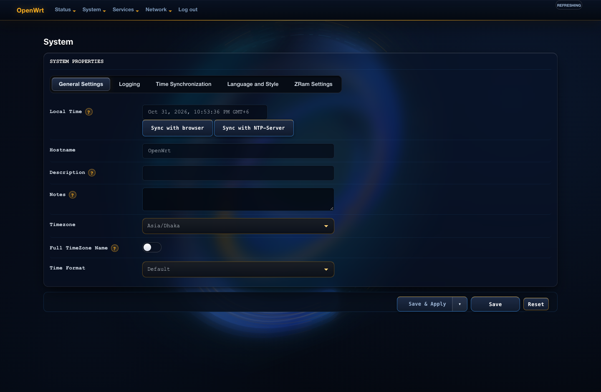
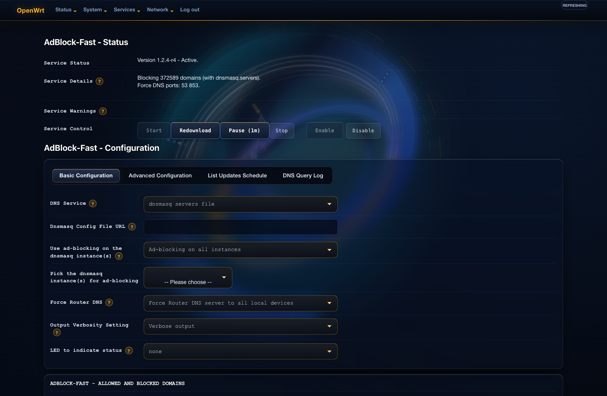
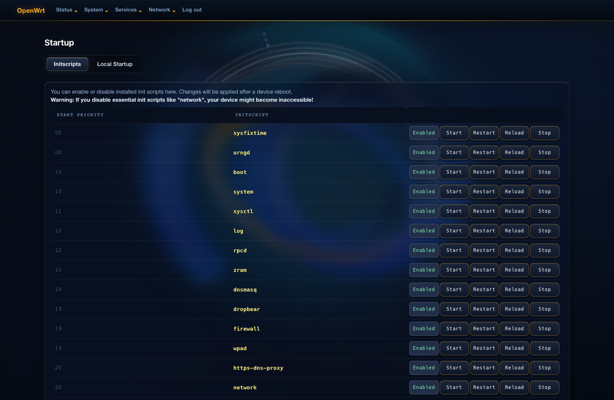

# luci-theme-darkstrap

A simple, clutter-free, and easy-to-use dark theme for OpenWrt LuCI.

Built for everyday router administration with high contrast, calm dark aesthetics, and zero visual noise.

## Clutter-Free Design

Standard LuCI pages often display multiple paragraphs of explanatory text under every single input field, which crowds the interface. Darkstrap moves field descriptions behind clickable indicator badges, keeping configuration forms clean and readable while keeping documentation accessible when needed.

### DNS & DHCP Configuration (Stock vs Darkstrap)



When help is needed, clicking any indicator reveals the field description in place:



## Screenshots

### System Overview

Hardware platform, firmware version, system load, and memory allocation.



### Wireless Management

Dual-band radio configuration (2.4 GHz and 5 GHz), channel allocation, signal meters, and associated stations.



### Firewall Zone Settings

General security policies, animated state toggles, and color-coded network zones (green LAN, red WAN).



### Realtime Bandwidth Monitoring

Live SVG traffic graphs with high-contrast curves for inbound and outbound interface bandwidth.



### System Settings & Time Synchronization

Timezone configuration, NTP time servers, and system logging properties.



### Services: AdBlock Fast

Manage network-wide content filtering and blocklist sources without interface lag.



### System Daemons & Startup Scripts

Service status and init scripts control.



## Key Features

- **Clutter-Free Forms**: Explanatory text is organized cleanly without overwhelming configuration views.
- **High-Contrast Dark Canvas**: Deep obsidian background with warm amber accents, comfortable on the eyes during late-night administration.
- **Modern Input Toggles**: Replaces raw checkboxes with clean, animated toggle switches.
- **Interface Badging**: Distinct color-coded badges for network zones and firewall rules.
- **Upstream Semantics**: Preserves 100% of LuCI client-side JavaScript, DOM structure, and accessibility hooks.
- **Responsive**: Adapts cleanly across mobile, tablet, and widescreen desktop monitors.

## Compatibility

- OpenWrt 21.02, 22.03, 23.05, 24.10, and SNAPSHOT.
- Compatible with all LuCI ucode-based releases.

## Installation

### Manual Installation (.ipk)

Download the latest `.ipk` package from [Releases](https://github.com/FhDBro/luci-theme-darkstrap/releases), copy it to your router, and install:

```sh
opkg install luci-theme-darkstrap_*.ipk
```

### Building from Source

In your OpenWrt SDK or buildroot tree:

```sh
cd package/feeds/luci/
git clone https://github.com/FhDBro/luci-theme-darkstrap.git
make menuconfig # LuCI -> Themes -> luci-theme-darkstrap
make package/luci-theme-darkstrap/compile
```

## Activation via UCI

To set Darkstrap as the default active theme:

```sh
uci set luci.main.mediaurlbase='/luci-static/darkstrap'
uci commit luci
/etc/init.d/uhttpd restart
```

## License

Licensed under the Apache License, Version 2.0.
